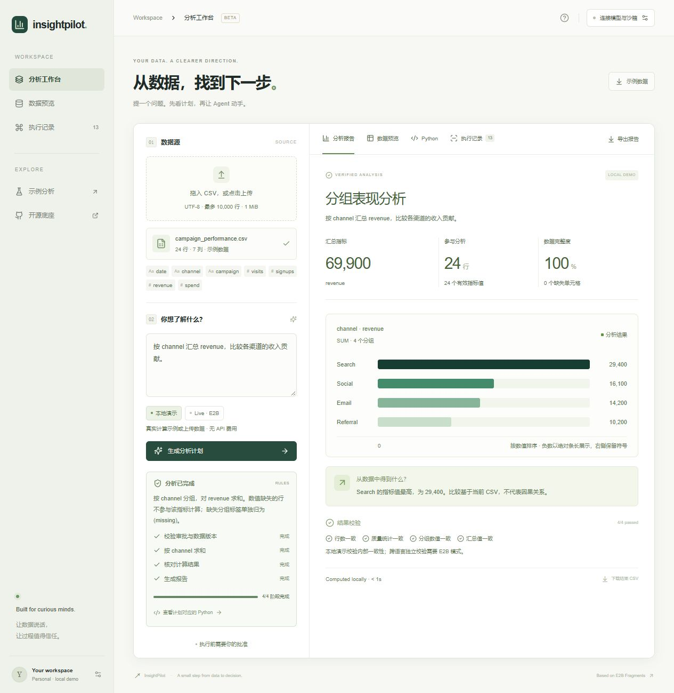
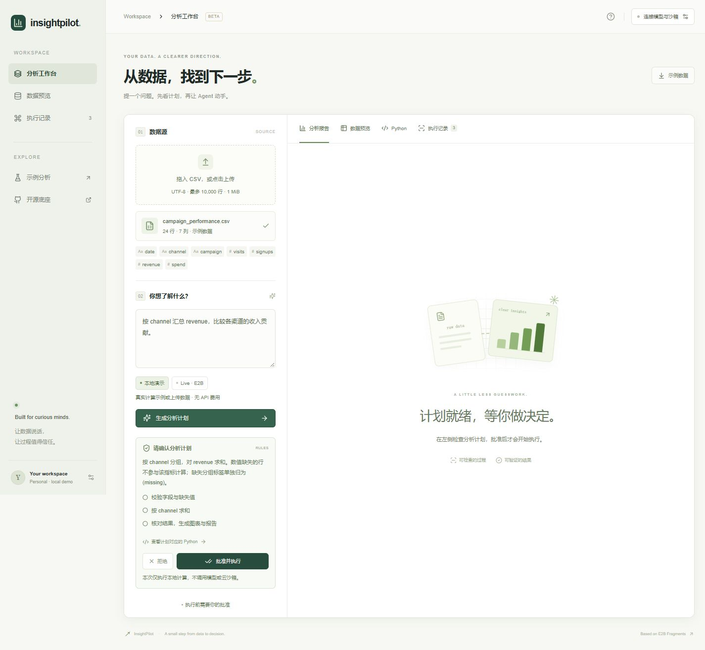
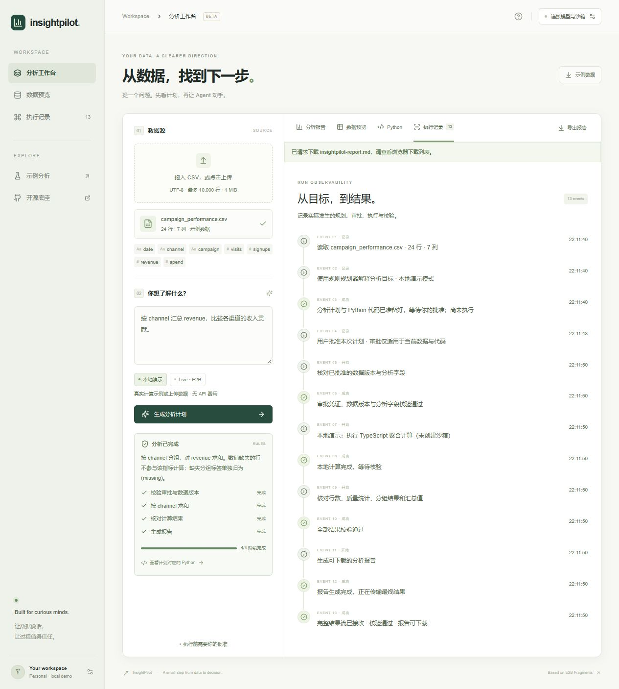
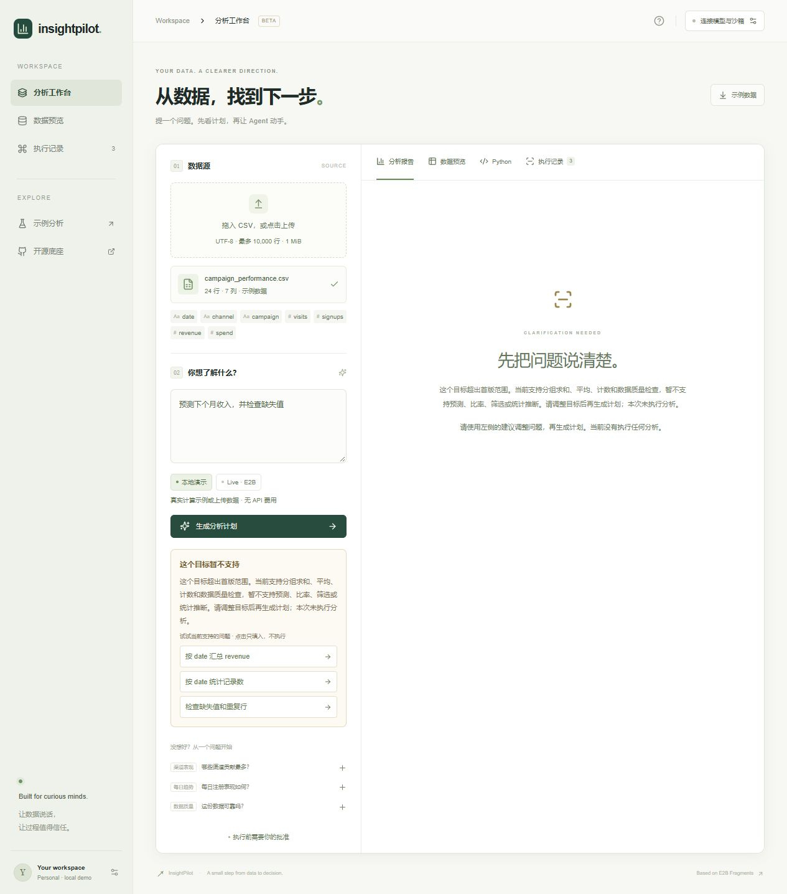

# InsightPilot

从数据，找到下一步。一个面向产品与运营人员、可以检查计划与验证结果的数据分析 Agent 原型。

基于 [E2B Fragments](https://github.com/e2b-dev/fragments) 二次开发，保留 Apache-2.0 许可证与上游完整 Git 历史。

## 线上演示

使用示例或上传 CSV 即可体验完整分析流程，无需 API Key。免费实例闲置后会休眠，唤醒可能需要约一分钟。 [打开 InsightPilot Demo](https://insightpilot-agent.onrender.com)

## 体验流程

上传 CSV → 输入分析目标 → 查看计划与 Python → 批准或拒绝 → 运行分析 → 校验结果 → 下载报告与结果 CSV。

- 支持分组求和、平均、记录计数、缺失值和完全重复行检查。
- 包含渠道收入、每日注册、数据质量三个演示问题。
- 示例数据为合成营销数据：24 行、7 列，收入合计 69,900。上传自己的数据会重新计算，不读取预置分析答案。
- 数据预览、等价 Python、实际执行事件与结果校验分开展示。
- 修改问题、数据或执行模式会废弃旧计划，重新请求批准。
- 待批准的聚合计划支持修改分组列、数值列和聚合方式。保存后重新生成 Python 并换发审批凭证，同一服务进程拒绝旧版本。变更与新版审批会出现在执行记录中。
- 对已识别的超范围目标、含糊目标或多项分析给出澄清提示和基于当前列名的建议；点击建议只填入问题，不会自动执行。
- 阶段状态来自实际服务端事件。仅在完整结果流结束且结果校验通过后发布报告；失败与沙箱释放警告在 Trace 中单独标识。
- 支持 Markdown、结果 CSV 与 Python 下载请求。质量检查 CSV 输出行数、缺失值与重复行统计，而非空聚合表。
- 运行历史可以回看已保存的计划、报告、Python 和执行记录。刷新后打开最近选择的历史，历史视图只读。

## 运行历史

浏览器本地最多保存 20 条记录，合计上限 2 MiB。记录包含问题、数据摘要、执行状态和已保存的分析产物。原始 CSV、API Key 和审批凭证不进入历史。问题、文件名、分组标签和报告仍可能含有业务信息，本地历史未加密，可单条删除或清空。

刷新不会发起新请求。恢复到待批准记录时只能查看，重新分析需要准备数据、生成新计划并重新批准。运行中断开后，历史显示“后台结果未知”。超出容量或浏览器拒绝保存时，当前工作台仍可查看和导出结果。

## 两种运行模式

默认开放 Demo。访客可以上传 CSV、修改计划、批准执行并导出报告，整个过程无需 API Key。公开环境应保留 `INSIGHTPILOT_ENABLE_LIVE=false` 或留空，服务端会拒绝 Live 规划、修改与执行。

| | 本地演示 | Live · E2B |
| --- | --- | --- |
| 规划 | 规则规划器 | DeepSeek JSON 规划 |
| 执行 | 本地 Node.js / TypeScript | E2B Python 沙箱 |
| Key | 不需要 | 自己的 DeepSeek 和 E2B Key |
| 结果 | 根据实际 CSV 计算 | Python 实际执行后返回 |
| 校验 | 内部一致性检查 | TypeScript 独立重算，与 Python 输出比较 |

本地演示没有创建沙箱，不是 LLM 自主推理。Live 规划仅从已支持的操作中选择字段与聚合方式，Python 由验证后的计划编译生成，不接受任意客户端代码执行。

在本地 `.env.local` 中设为 `INSIGHTPILOT_ENABLE_LIVE=true` 并重启服务后，可在右上角连接自己的 DeepSeek 和 E2B。两项 Key 只保存在当前标签页的 `sessionStorage`，刷新后可恢复，主动清除连接时删除。Key 经同源请求头转发，不进入模型提示词或沙箱文件。新工作台不会使用部署所有者的模型 / 沙箱 Key。

规划时 DeepSeek 接收列信息和最多前 5 行样本；用户批准后 E2B 才接收完整 CSV。模型额度与沙箱额度分别计费。保存连接只表示已配置，实际 API 连通性在运行时确认。

## 本地启动

要求 Node.js 24 与 npm。Python 3 为可选项，用于本地跨语言等价性测试，不是启动工作台的前提。

```bash
npm ci
npm run dev -- --port 3001
```

打开 [http://localhost:3001](http://localhost:3001)。先用本地演示模式生成计划并批准即可体验，不需要 `.env.local`。

```bash
npm run lint       # ESLint；保留的上游界面有既有 warnings
npm run typecheck  # TypeScript
npm test           # 含上游回归与新增分析、审批、API、适配器测试
npm run build
```

有 Python 时，默认测试还会实际执行生成的 Python，并与 TypeScript 的 sum / mean / count 结果对照；没有 Python 时仅跳过这三项。默认测试不调用付费模型或创建云沙箱。

本地验收记录、测试范围与未验证项见 [verification.md](docs/verification.md)。
求职展示材料见 [InsightPilot 产品案例与演示脚本](docs/portfolio-case.md)。

## 界面预览










## 二开内容与来源

上游基线：`3b11c7fcd4dcc37b2f1effde35960cf6ec4bd3c7`。

| 来源 | 内容 |
| --- | --- |
| E2B Fragments | Next.js / React / Tailwind 工程、E2B SDK、Fragment 类型、Radix UI 基础组件、原始应用与 76 项上游测试 |
| InsightPilot 新增 | CSV 解析与画像、分析工作台、受限规划、签名审批、执行事件流、Python 编译、受控 E2B 生命周期、数值核验、报告导出与新增测试 |

原始 Fragments 页面保留于 `/playground`，原文档见 [upstream-readme.md](docs/upstream-readme.md)。该页面、旧聊天与沙箱 API、发布链接和相关操作默认关闭。只有同时设置 `INSIGHTPILOT_ENABLE_LIVE=true` 和 `ENABLE_FRAGMENTS_PLAYGROUND=true` 才会启用旧入口，供本地研究原项目使用。

## 文件结构

```text
app/
  page.tsx                 # InsightPilot 入口
  workspace.css            # 分析工作台样式
  api/analysis/plan/        # 数据画像、规则 / LLM 规划、签发审批
  api/analysis/revise/      # 校验计划修改、换发审批凭证
  api/analysis/execute/     # 校验审批、执行、数值核验、NDJSON 事件流
  playground/              # 保留的上游页面
components/analysis/       # 数据源、计划、连接面板、图表 / 结果 / Trace、历史视图
lib/analysis/
  csv.ts                   # CSV 解析、限制与画像
  planner.ts               # 规则与 DeepSeek 规划
  planning-feedback.ts     # 澄清与当前数据可用问题建议
  approval.ts              # 签名、数据绑定、过期与进程内防重放
  python.ts                # 编译为上游 Fragment 格式的 Python
  sandbox.ts               # E2B 创建、上传、执行与释放
  compute.ts               # TypeScript 参考计算与结果对照
  execution-progress.ts    # 执行阶段与 Trace 状态类型
  execution-stream.ts      # 严格解析事件流，完整结束后才发布结果
  download.ts              # CSV 内容与浏览器下载交接
  history-types.ts         # 历史字段投影与结构校验
  history-repository.ts    # 本地历史读写、配额和订阅
  history-session.ts       # 当前运行的历史状态记录
  use-run-history.ts        # 只读选中状态与刷新恢复
  use-workspace.ts         # 用户工作流与会话级凭证
docs/
  design.md                # 首版设计和验收范围
  upstream-readme.md        # 上游文档
```

## 当前边界

- CSV 为 UTF-8，最多 1 MiB、10,000 行、40 列；不支持 Excel、复杂筛选、预测、统计显著性或因果分析。
- 规则规划器使用有限关键词与列名识别，并非通用自然语言理解；Live 模型也可能理解有误，仍需用户检查计划。每次计划只覆盖一种受支持分析。
- 聚合不自动去重。数值指标缺失时该行不参与该指标计算；缺失分组标签归为 `(missing)`。
- 原始上传数据随当前页面保留，API Key 使用标签页会话存储，分析产物使用当前站点的浏览器本地历史。历史不跨设备同步。
- Demo 与 Live 的审批验证和防重放默认都依赖同一 Node 进程。公开演示目前适合单实例部署。多实例部署需要跨路由一致的签名密钥和共享防重放存储。
- E2B 生命周期上限 90 秒，Python 执行上限 30 秒；执行后会尝试释放。释放未确认时界面明确显示，生命周期上限仍保留。
- E2B 执行网络关闭，沙箱只接收数据和编译后的分析代码。
- 已通过真实 HTTP 接口联调，以及一次合成数据的 Live 浏览器流程：DeepSeek 规划 → 页面审批 → E2B Python 执行 → 独立结果核验 → 沙箱释放；同时验证了刷新恢复会话连接和主动清除连接。默认自动测试使用模拟 Provider。验收记录与截图见 [verification.md](docs/verification.md)。
- 当前没有自动修复任意 Python 错误的多轮 Agent Loop；错误会展示并要求重新规划。
- 当前共 164 项自动测试通过。内置浏览器已验收 Markdown、CSV 和 Python 下载，Chrome 已复测 Markdown。Edge 下载仍待验收。

## License

[Apache-2.0](LICENSE)。项目基于 E2B Fragments，二开来源说明见 [NOTICE](NOTICE)。
